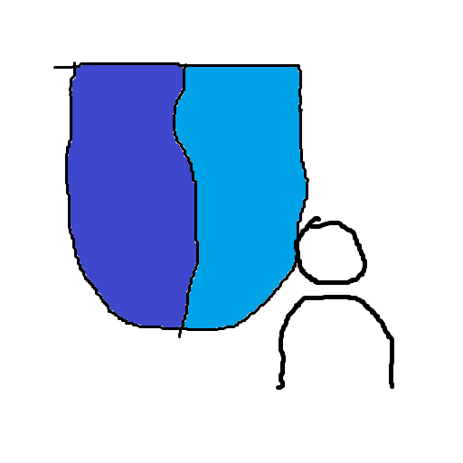

   

<h1>Authentication</h1>

为你的西大不丢饿加一把锁

> [!NOTE]
> 该插件已在 Class Widgets 2.0.0.dev20261014 版本上验证可用。

## 介绍 / Introduction

本插件为 Class Widgets 2 提供密码与 Windows Hello 身份验证。

本插件基于 [Class Widgets 2 SDK](https://github.com/Class-Widgets/class-widgets-sdk)。

### 功能 / Features

- **认证方式**
  - **密码**：本地 PBKDF2-HMAC-SHA256 哈希存储
  - **Windows Hello**：使用系统原生 PIN/生物识别弹窗（需设备已配置 Windows Hello）
  - 同时启用多种方式时，先弹出选择窗口，任一通过即可

- **验证触发时机**
  - 程序启动
  - 打开设置 / 打开课程编辑器
  - 插件的安装、卸载、导入、更新、启用、禁用
  - 退出程序

### 兼容性说明

- 只有插件能够识别的入口会被挂钩；若西大不丢改变了入口方法，对应触发项会失效
- Windows Hello 仅限 Windows 平台

## 使用 / Usage

1. 在插件广场（网页版/客户端）中 [下载](https://plaza.cw.rinlit.cn/plugins/authentication.lyang1273) / In Plugin Plaza (Web / Class Widgets Client), [download](https://plaza.cw.rinlit.cn/plugins/authentication.lyang1273) this plugin

2. 在 Class Widgets 2 ->「设置」->「插件」中导入并启用本插件 / Import and enable this plugin in "Settings" -> "Plugins"

3. 在插件的「登录选项」设置页中：
   - 添加密码或 Windows Hello 认证方式（首次添加密码时设置并确认密码）
   - 打开需要验证的触发项（至少启用一项）

> **注意**
> 此插件不能保证你的 Class Widgets 完全安全

## 致谢 / Acknowledgements

### 引用资源 / Credits

- [Class Widgets 2](https://github.com/rinlit-233-shiroko/class-widgets-2)
- [Class Widgets 2 SDK](https://github.com/Class-Widgets/class-widgets-sdk)
- [winrt-runtime](https://github.com/pywinrt/pywinrt)
- [loguru](https://github.com/Delgan/loguru)

### 贡献者们 / Contributors

## 版权 / License
本项目基于 MIT 协议开源，详情请参阅 [LICENSE](https://github.com/Lyang1273/authentication_cw_pigu/blob/main/LICENSE) 文件。

The project is licensed under the MIT license. Please refer to the [LICENSE](https://github.com/Lyang1273/authentication_cw_pigu/blob/main/LICENSE) file for details.

###### ~~这是对 Vibe Coding 一次伟大的尝试！~~